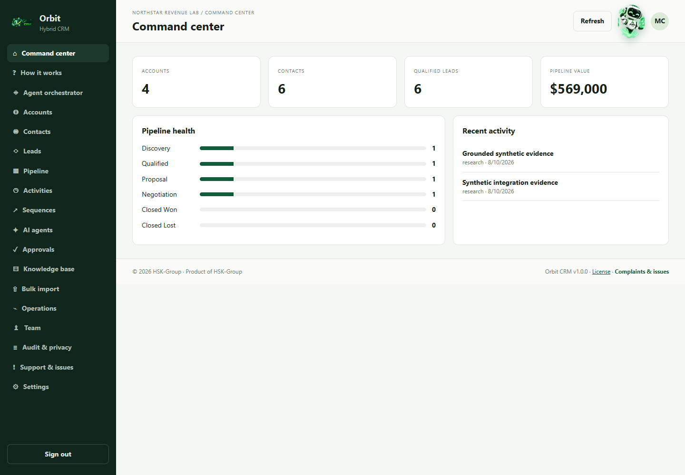
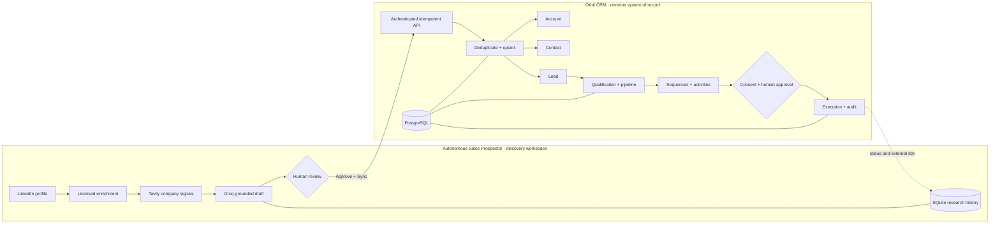
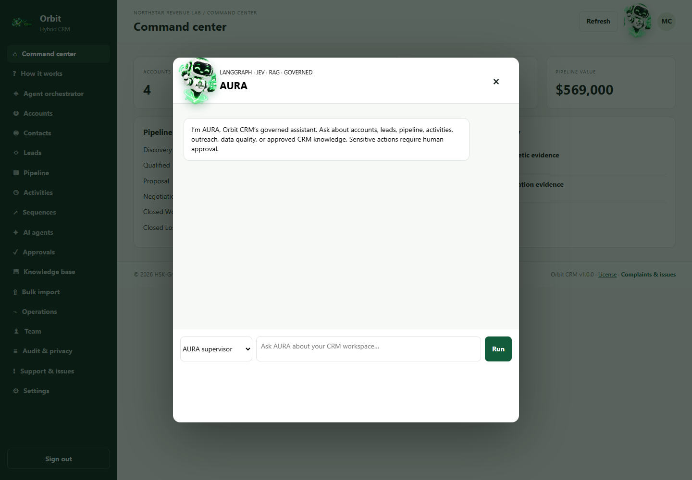
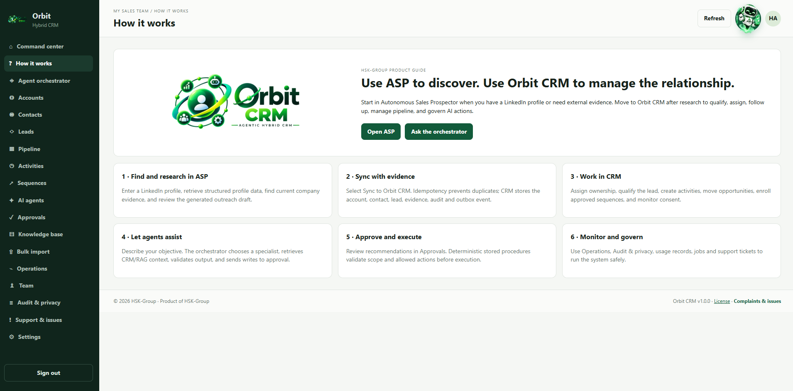

# Orbit — Agentic Hybrid CRM



Orbit is the governed system of record for accounts, contacts, leads, opportunities, activities, sequences, consent, agent recommendations and audits. It receives reviewed prospect intelligence from [Autonomous Sales Prospector](https://github.com/HamzaAhmedKhan786/autonomous-sales-prospector).

## How Orbit and ASP work together



| Data | Created in ASP | Visible in Orbit CRM |
| --- | --- | --- |
| Person and company identity | Profile enrichment | Contact and account |
| Research evidence | Tavily-backed sources | Research activities with source URLs |
| Research score | Grounded prospect result | Lead score and explanation |
| Sync state | Provider, time and CRM lead ID | ASP integration heartbeat and CRM records |
| Outreach draft | Human-editable draft | Governed email agent or sequence context |

The products intentionally keep separate databases. ASP retains research history in SQLite; Orbit keeps operational sales data in PostgreSQL. Synchronization is explicit, tenant-scoped, authenticated with `ASP_SHARED_SECRET`, idempotent, and audited.

## Production documentation

- [Architecture](docs/architecture.md)
- [AI product requirements](docs/PRD.md)
- [End-to-end ASP, agent, RAG and MCP flows](docs/flows.md)
- [Agent catalog and governance](docs/agents.md)
- [API reference](docs/api.md)
- [Configuration reference](docs/configuration.md)
- [Deployment and operations](docs/production.md)
- [Security model](docs/security.md)
- [Privacy runbook](docs/privacy.md)
- [Production owner checklist](docs/owner-checklist.md)
- [Local operations runbook](docs/runbook.md)

The application is production-oriented, but launch is conditional on the owner checklist. Managed infrastructure, credentials, vendor/legal choices, external-service validation, monitoring, backup restore, security review and privacy approval cannot be completed by source code alone.

Orbit is an independent, multi-workspace CRM connected to Autonomous Sales Prospector (ASP). PostgreSQL is the operational source of truth. Groq agents retrieve context and propose structured actions; deterministic PostgreSQL policies, human approvals and immutable audits control mutations.

### AURA governed assistant

AURA uses LangGraph for deterministic state and checkpoints, optional JEV TypeSafe decisions for bounded routing, specialist handoffs for CRM work, and an evaluator before returning a result. JEV is a decision model—not the conversational generator—and never replaces tenant authorization or approval policy. Langfuse/OpenTelemetry traces and Prometheus/Grafana metrics are optional operator integrations. See the [AI PRD](docs/PRD.md).

The AURA and SIERRA launchers use lightweight CSS animation with a reduced-motion fallback; no external animation service or tracking script is loaded.

AURA uses a high-resolution eight-frame transparent sprite loop for articulated waving, body rotation, and orbital-light movement. The browser renders the frames directly, avoiding the color and edge artifacts of low-resolution GIF files.



### Guided ASP-to-CRM workflow



## Product workflow and agent orchestration

Orbit CRM v1.0.0 includes an in-app **How it works** guide, a governed orchestrator, and workspace-scoped support tickets. ASP handles external prospect discovery, evidence, and draft creation. After human review, Orbit CRM handles deduplication, ownership, qualification, pipeline, consent, sequences, approvals, and reporting. The orchestrator deterministically selects the appropriate specialist; proposed writes remain subject to approval policy and audit trails.

Orbit CRM is proprietary software of HSK-Group. See [LICENSE.md](LICENSE.md).

## Product surface

- Responsive web app: dashboard, accounts, contacts, leads, pipeline, activities, sequences, agents, approvals, knowledge, integrations, team, audit/privacy and settings.
- Session authentication, organization memberships and workspace context.
- CRM assistant plus qualification, research, pipeline-risk, email, data-quality and MCP agent modes.
- PostgreSQL RAG ingestion, overlap chunking, full-text retrieval and citations.
- MCP JSON-RPC endpoint with tool discovery/calls and approval boundaries for writes.
- CRM records, workflows, sequences, notifications, jobs, usage, audit and GDPR storage.
- Idempotent ASP ingestion, bounded bulk import, transactional outbox and Snowflake-ready semantic views.

## Local setup

```powershell
npm install
Copy-Item .env.example .env
npm run db:migrate
npm run db:seed
npm run dev
```

Run `npm run worker` separately and open `http://localhost:4100`.

Synthetic login: `maya.chen@example.test`; password is `BOOTSTRAP_ADMIN_PASSWORD`, or `ChangeMe123!` when omitted for local development. Change it before exposing the service. Never commit `.env`.

The seed command creates realistic accounts, contacts, leads and opportunities across multiple stages, so Pipeline Health and the dashboard are populated immediately after local setup. It is idempotent and safe to rerun.

## Important endpoints

- `POST /api/v1/auth/login`
- `GET /api/v1/dashboard` and `GET /api/v1/{resource}`
- `POST /api/v1/agents/run`
- `POST /api/v1/agent/recommendations/:id/{approve|reject|execute}`
- `POST /api/v1/knowledge/documents`, `GET /api/v1/knowledge/search`
- `POST /api/v1/mcp`
- `POST /api/v1/asp/prospects`, `POST /api/v1/bulk/prospects`
- `POST /api/v1/privacy/requests`

All CRM routes require a session token or API key and organization context. ASP uses its shared secret.

## Validation

```powershell
npm run build
npm test
npm run db:check
```

See [architecture](docs/architecture.md), [agents](docs/agents.md), [API guide](docs/api.md), [security](docs/security.md) and [runbook](docs/runbook.md).
