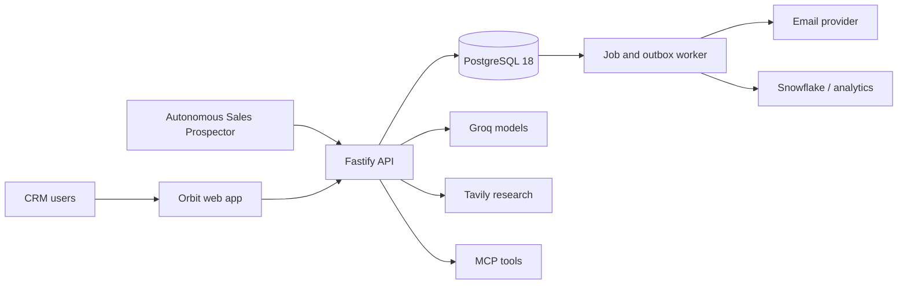
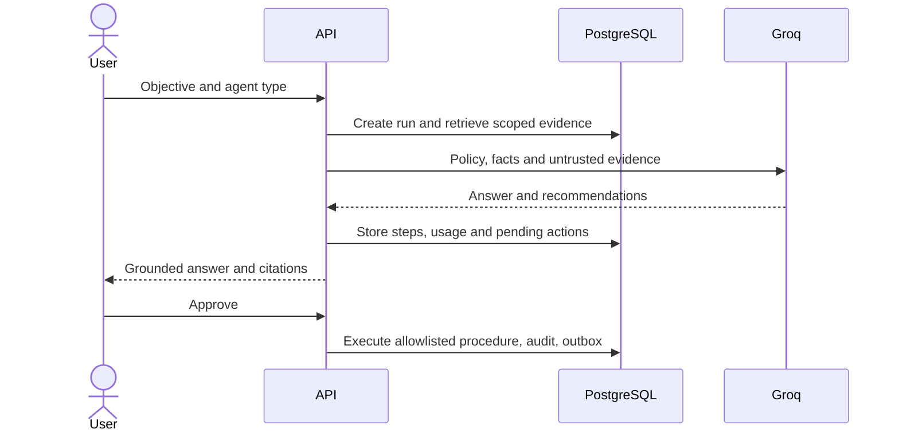
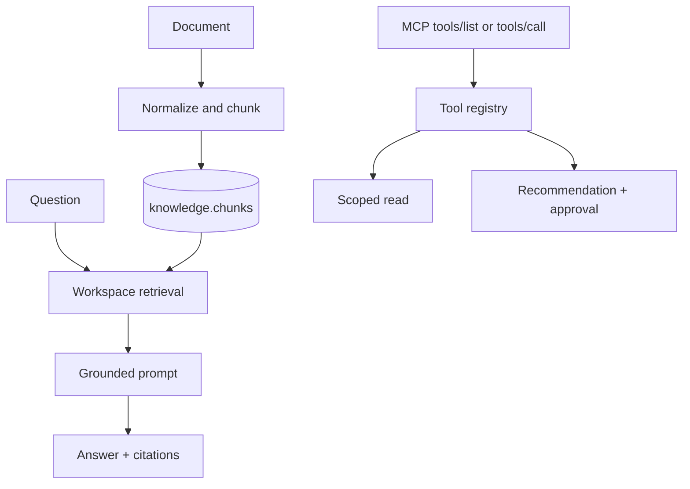

# Architecture

ASP owns external research and draft generation. CRM owns customer truth, pipeline, activity, governance and workflow execution. Snowflake is analytical and never on the transactional write path.

## Governed agent flow

## RAG and MCP

Agents never receive database credentials, emit direct SQL or execute arbitrary writes. Write tools become recommendations; stored procedures enforce the allowlist.
