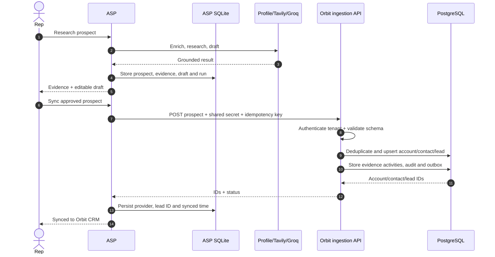
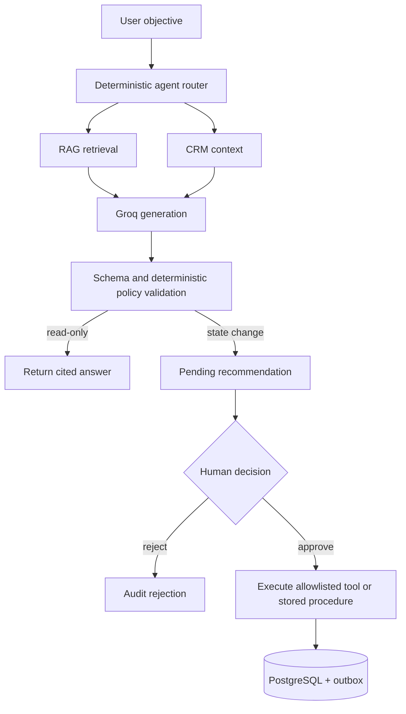
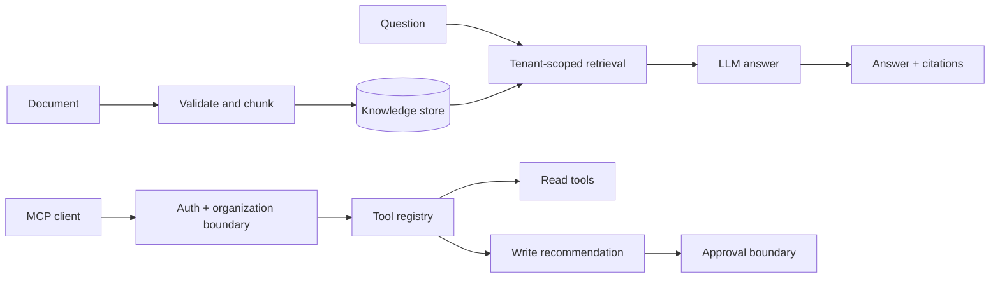

# System flows

## ASP to CRM

### Shared data contract

| ASP field | Orbit destination | Behavior |
| --- | --- | --- |
| LinkedIn URL | Contact identity key | Workspace-scoped duplicate detection |
| Name and role | Contact | Updated through the ingestion procedure |
| Company | Account | Reused when the normalized company matches |
| Score and explanation | Lead | Preserves the research origin |
| Evidence title, URL and summary | Research activity | Source remains inspectable |
| Correlation and idempotency keys | Integration/audit records | Safe retries without duplicate CRM records |

## Governed agent action

## RAG and MCP

