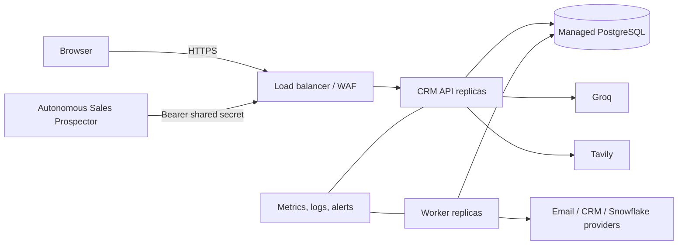

# Production deployment and operations

## Release topology

Run the API and worker from the same immutable image, backed by managed PostgreSQL. Put the API behind a TLS-terminating load balancer; the worker must not be public. Store secrets in the platform secret manager, not image layers or repository variables.

## Required release procedure

1. CI must pass tests, TypeScript compilation and image build.
2. Back up PostgreSQL and verify the latest restore drill.
3. Deploy the image by digest to a staging environment.
4. Run `npm run db:migrate` once as a release job; migrations must not run concurrently.
5. Smoke-test `/health`, login, dashboard, a read-only agent run, approval creation, and ASP ingestion.
6. Deploy API, then worker, using rolling replacement. Keep the previous digest available for rollback.
7. Watch error rate, p95 latency, database connections, pending recommendations and outbox age.

## Health, scaling and shutdown

- Liveness/readiness: `GET /health` returns `200` only when PostgreSQL is reachable.
- API replicas are stateless; sessions are stored in PostgreSQL. Scale horizontally behind sticky-free load balancing.
- Run at least one worker. Scale only after confirming outbox processing uses safe row claiming.
- Set the platform termination grace period to at least 30 seconds.
- Alert when `/health` fails twice, 5xx exceeds 2% for five minutes, or the oldest outbox item exceeds five minutes.

## Backup and recovery

- Enable point-in-time recovery, daily snapshots, encryption and cross-region copy on managed PostgreSQL.
- Retain daily backups for 35 days and monthly backups according to the approved retention schedule.
- Quarterly, restore into an isolated environment and record RTO/RPO. A backup that has not been restored is unverified.
- Export audit records before destructive retention jobs only when the legal basis permits retention.

## Rollback

Application rollback means redeploying the previous image digest. Database migrations are forward-only: write a compensating migration, never edit an applied migration. If a migration is incompatible, stop the rollout, restore only with explicit incident-owner approval, and reconcile any writes made since the backup.

## Platform examples

Any container platform works (Cloud Run, ECS/Fargate, Azure Container Apps, Fly.io, Render). Configure two process types from the same image:

- API: `node dist/src/server.js`, public port `4100`.
- Worker: `node dist/src/worker.js`, no public port.
- Migration job: `node dist/scripts/migrate.js` with the production `DATABASE_URL`.

Do not use the development Compose database for production.

